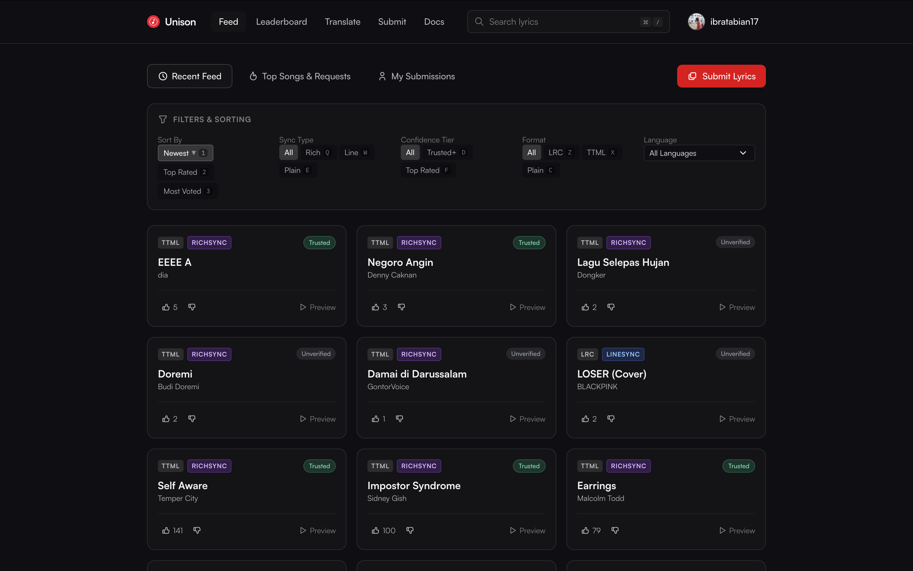

# Yet Another Unison Client



A modern, standalone web client for the [Better Lyrics](https://betterlyrics.org) Unison ecosystem. Explore community lyrics, submit and sync new tracks with Apple Music auto-matching, translate lyrics across 130+ languages, and inspect curator leaderboards and Council workflows.

---

## ✨ Features

- **Dual Interface Mode (New UI & Classic UI) with First-Time Onboarding (FTUE)**
  - **New UI (Immersive)**: Features Unison's latest design language with Kawarp WebGL shader cover washes, hover cover previews, glassmorphic navigation & action chips, `SongHero` + `SongRail` song layout, `FeedGrid` & `SongCoverTile` grids, and interactive curator share cards (`ProfileCard`, `ProfileSide`, `BannerPicker`, `XpAvatar`).
  - **Classic UI (Compact)**: Preserves the clean solid-surface layout (`VariantMetadata` sidebar, boxed `LyricsPanel`, classic `ProfileHeader` + `StatPills`, and compact Feed cards).
  - **FTUE & Settings**: Pick your preferred UI on first launch or switch anytime via the Settings modal or `/settings` page.

- **Full Unison & Better Lyrics Feature Parity**
  - **Council Dashboard**: Includes Seal Queue, Edits, Metadata Proposals (`/council/metadata`), Flags & Reports (`/council/flags`), Bookmarks, Applicants, Activity Log with Vote Strike undo, and Members.
  - **Provider & ISRC Lookups**: Look up lyrics directly by ISRC, Spotify ID, Apple Music ID, or Tidal ID (powered by BiniLink) as well as YouTube video IDs.
  - **Braccato 1.19+ & Syntax Highlighting**: Full word/syllable sync, romanization & translation injection, user-scroll detection with "Resume autoscroll", and `@braccato/highlight` raw LRC/TTML highlighting.
  - **Submit, Edit, Revisions, Linked Videos & Translator**: Upload or paste `.ttml`/`.lrc`/`.txt` lyrics, auto-match metadata with Apple Music, inspect or revert lyric revisions, link alternate YouTube video variants, and translate/romanize lyrics in bulk.

---

## 🚀 Getting Started

### Prerequisites

- [Node.js](https://nodejs.org/) (v20 or higher recommended)
- `npm` or `pnpm`

### Installation

1. Clone the repository:
   ```bash
   git clone https://github.com/ibratabian17/unison-client.git
   cd unison-client
   ```

2. Install dependencies:
   ```bash
   npm install
   ```

3. Start the local development server:
   ```bash
   npm run dev
   ```
   Open `http://localhost:5173` in your browser.

---

## 🛠️ Build & Deployment

### Production Build

```bash
npm run build
```
Build output is generated in the `dist/` directory.

### Preview Local Build

```bash
npm run preview
```
